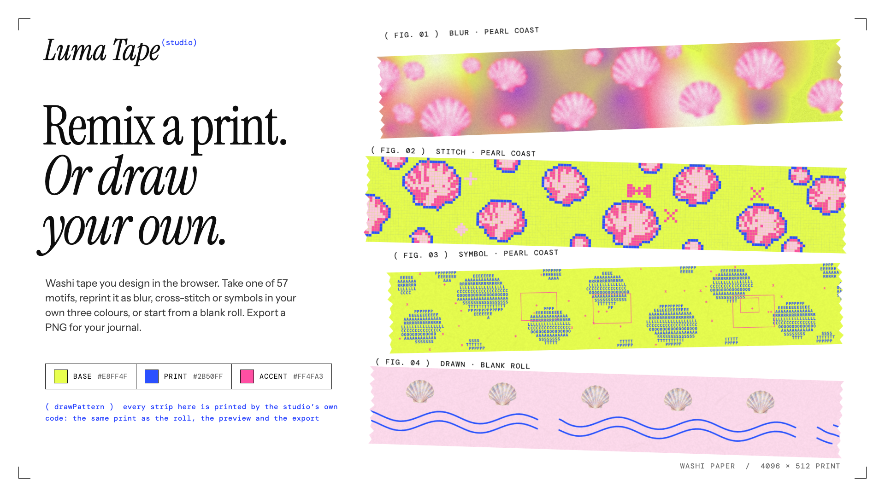
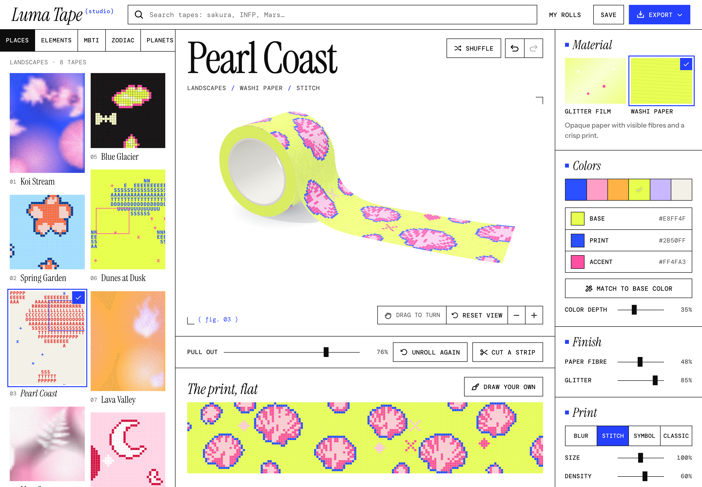
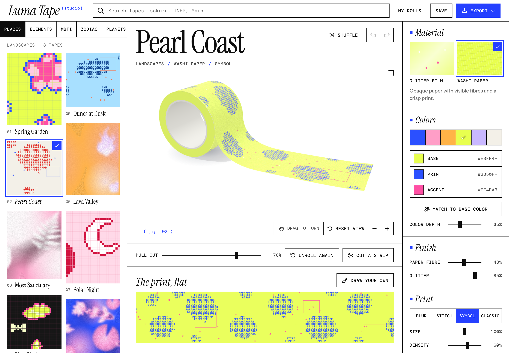
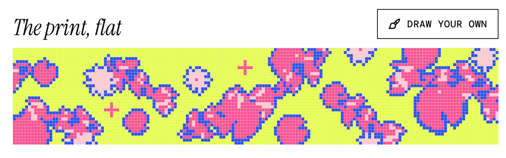
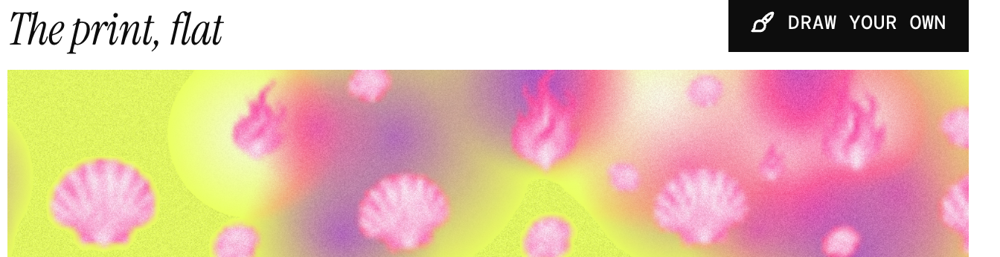
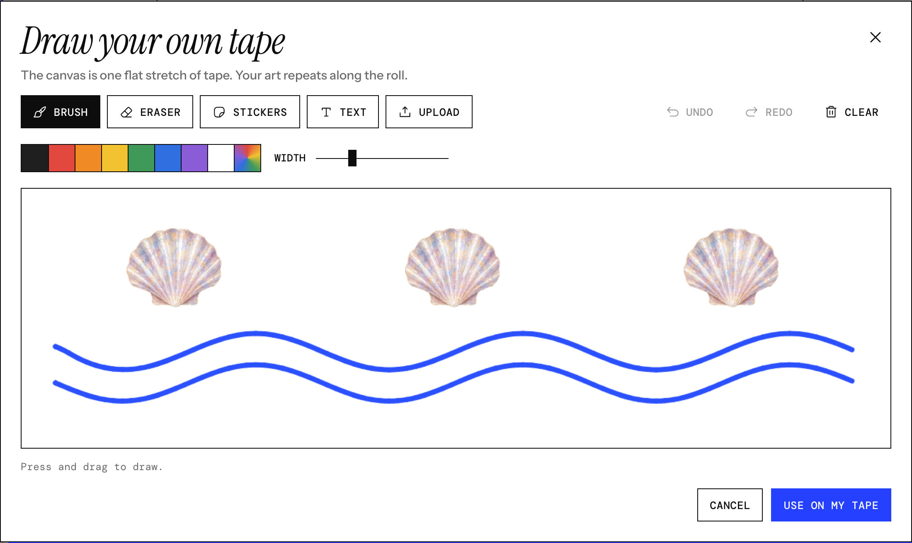

# Luma Tape

English · [简体中文](README.zh-CN.md)

**Design your own digital washi tape. Draw from scratch, or make an existing template yours with custom colours and print styles. Export a PNG for your journal, notes or next post.**

[Open the studio →](https://cynthiawongss.com/luma-tape/)



*Every strip above was printed by the studio's own code, the same print the roll and the exports use. The screenshots below are from the live app.*

## Two ways to make it yours

| Design from scratch | Remix a template |
| --- | --- |
| Open **Blank roll** to draw, arrange stickers, add text or upload your own artwork. You choose what goes on the tape and where it goes. | Pick a template, change its **Base, Print and Accent** colours individually, then try another print style or material. |

The flat preview, the roll and the exported image use the same print, so you can see your changes as you work.



| Make it yours | What you can change |
| --- | --- |
| Start with a motif | 57 motifs across Places, Elements, MBTI, Zodiac, Planets and Florals, plus a blank roll. |
| Try another print | **Blur**, **Stitch**, **Symbol** or **Classic**: see below. |
| Set the colours and material | Base, print and accent colours; opaque washi paper or clear glitter film. Match colours automatically, or Shuffle for a new combination. |
| Add your own marks | Draw, erase, add text, use 39 stickers or upload an image. Undo and redo while you work. |
| Keep a collection | Save designs in My rolls, rename them and return to them in the same browser. |

## One motif, four ways to print it

Luma Tape treats a tape as a print rather than a sticker sheet. Any motif can be printed four ways, and your three colours drive each of them.

| Print | What it does |
| --- | --- |
| **Blur** | Soft focus and film grain. Every illustration is recoloured through your palette, so none keeps its original colours. |
| **Stitch** | Pixel cross-stitch on an even-weave grid: flat thread colours, a dark outline and small pixel charms in the gaps. |
| **Symbol** | Each shape is typeset from rows of letters that spell the tape's own name, with small technical marks around it. |
| **Classic** | The original watercolour illustrations. |

Blur, Stitch and Symbol borrow from contemporary graphic design: soft-focus grain, pixel cross-stitch, type-built symbols and saturated colour clashes, rather than the nostalgic watercolour look of most journal tape. Classic keeps that original artwork for anyone who wants it.



What you see is what you export. The roll, the flat preview, the library covers and every PNG are drawn by the same print function, so they never disagree.

## Your colours, your take on a template

Shells and marine motifs can become a cross-stitch print in acid lime, pink and cobalt, or a soft, grainy blur. These two studio screenshots show the possibilities. All three colours are editable; you can go beyond the template's starting palette.





## Start blank. Draw and arrange your own.

Open **Blank roll** to create your own design. In this example, blue waves were drawn with the brush and three shell stickers were placed on the canvas. You can also add text or upload an image. Choose **Use on my tape** to apply your artwork to the roll.



[View the actual flat-strip export of this custom design](docs/intro/custom-coast-flat.png)

## Take your design with you

| Export | Size | Use it for |
| --- | --- | --- |
| Flat strip | 3072 × 512 PNG | Place a repeating strip in GoodNotes or another digital journal. |
| Sticker, transparent | 2400 × 1400 PNG | Layer a cut strip over a page without a rectangular background. |
| Showcase, white | 2400 × 1600 PNG | Share the whole roll at your chosen angle. |

## Try it

1. [Open Luma Tape](https://cynthiawongss.com/luma-tape/) and choose **Blank roll** to design from scratch, or pick a template from the left-hand library.
2. Adjust the print, palette and material. Drag the roll to turn it; pull out more tape or cut a strip.
3. Save it in **My rolls**, or choose a PNG from **Export**. No account is needed.

Arrow keys turn the roll, **Home** resets the view, and **⌘Z / ⇧⌘Z** undo and redo.

## Your work and your data

Saved rolls stay in this browser's `localStorage`. There is no account or cloud sync: export your work before clearing site data or moving to another device. Fonts load from Google Fonts, with system-font fallbacks when offline.

Luma Tape makes digital images; it does not print or order physical tape. The four print styles redraw the same 37 illustrations (a sheet of 36 plus the koi), so motifs are shared across styles.

## Run locally

Built with React 19, Vite and Three.js. Requires Node.js 20.19 or newer.

```sh
npm ci
npm run dev
```

To check and build:

```sh
npm test
npm run build
```

Pushes to `main` run the tests and build before publishing through GitHub Pages. If either fails, the previous live version remains available.

## Rights

Copyright © 2026 Cynthiawongss. **All rights reserved. This is a public showcase, not an open-source project.**

You may view the work and fork the repository as GitHub's Terms of Service allow. Reusing, modifying or redistributing the code, illustrations, print styles or designs requires written permission.

Tapes you design on the published site and the PNGs you export may be used in your own journals, notes and posts. Do not resell the built-in illustrations as sticker packs or stock assets. Third-party software and fonts retain their own licenses.

See [LICENSE](LICENSE) for the full terms. To ask for permission, open an issue.
