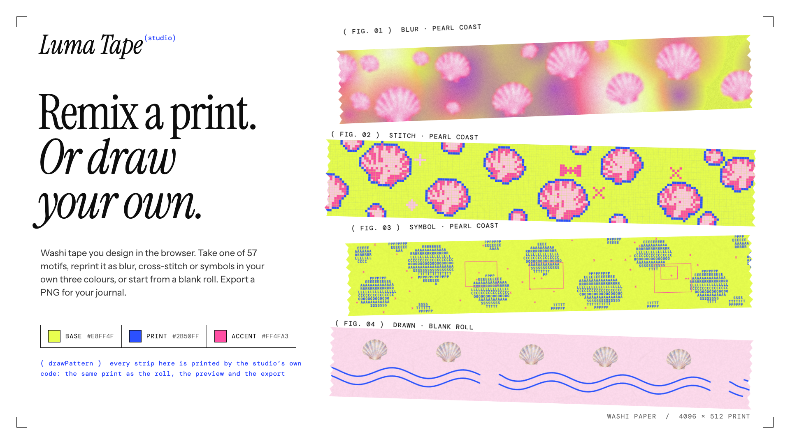
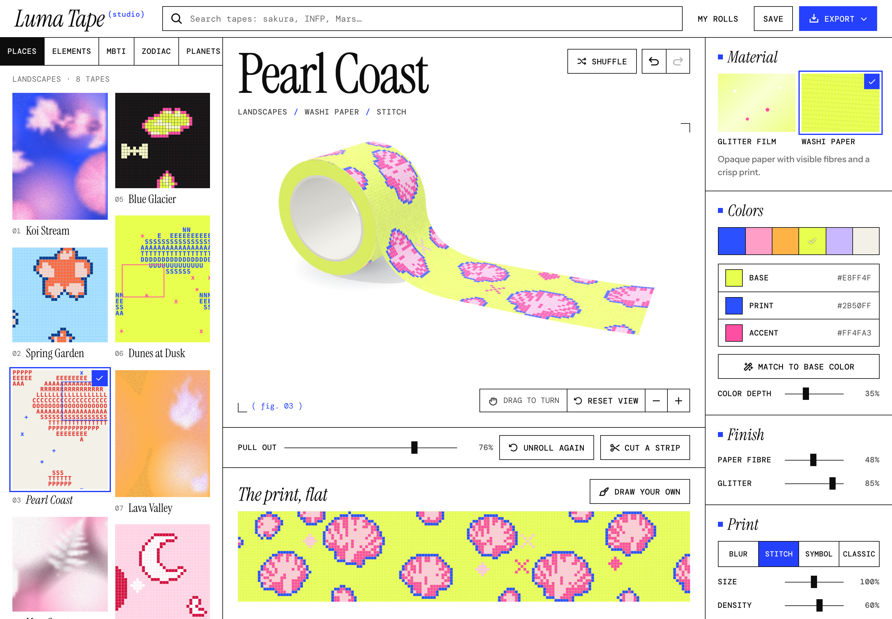
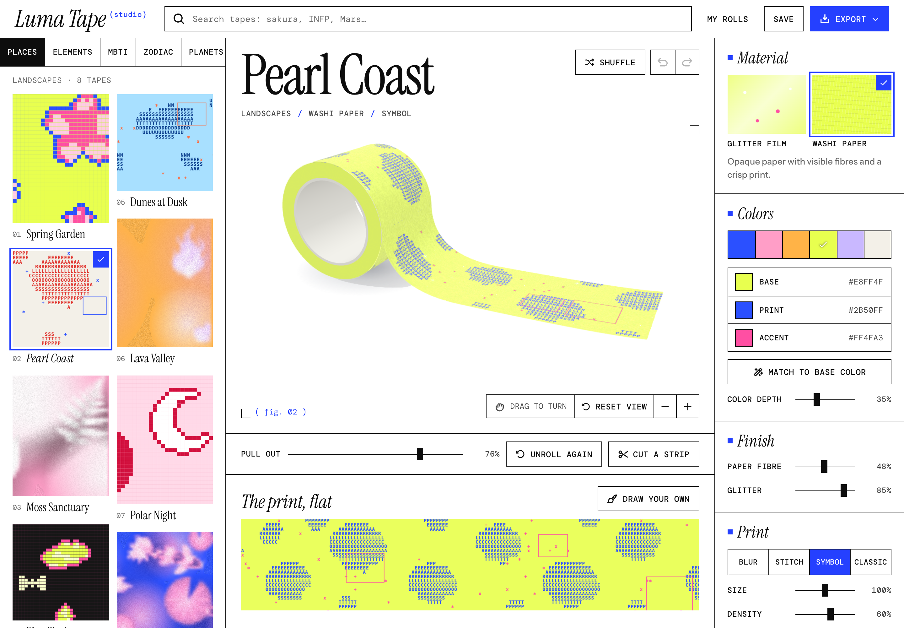
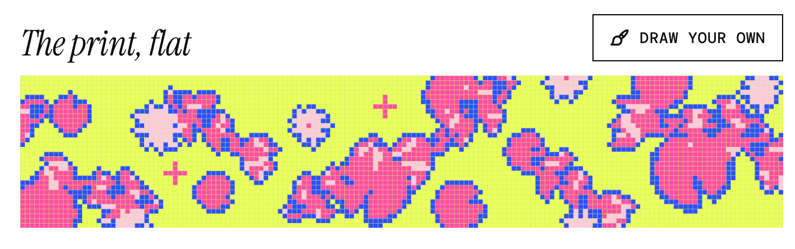
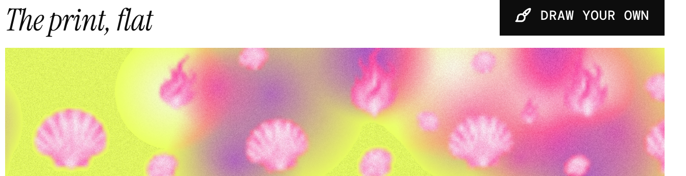
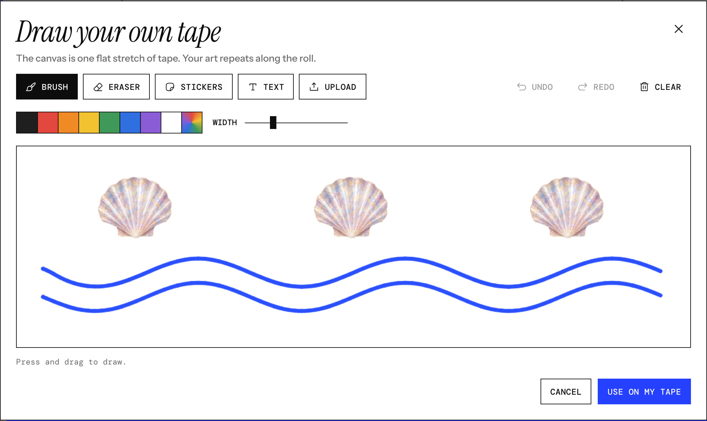

# Luma Tape

[English](README.md) · 简体中文

**自己设计一卷数字纸胶带：从空白画布自由创作，也能在现有模板上调整颜色和印花。做好后导出 PNG，贴进手账、笔记或下一篇帖子。**

[打开胶带工作室 →](https://cynthiawongss.com/luma-tape/)



*上图每一条胶带都由工作室自己的代码印出，和卷筒、导出图用的是同一套印花。下方截图均来自实际运行的网站。*

## 两种起点，都能做成自己的设计

| 从空白开始设计 | 在现有模板上调整 |
| --- | --- |
| 打开 **Blank roll**，用画笔自由绘制、放置贴纸、加入文字，或上传自己的图片，决定胶带上有哪些内容、放在哪里。 | 选择一个喜欢的模板，分别调整 **Base 底色、Print 印花色、Accent 点缀色**，再尝试不同印花风格和材质。 |

平面预览、卷筒和导出图片使用同一套印花，可以边改边看效果。



| 想做什么 | 可以怎样调整 |
| --- | --- |
| 找一个起点 | 从 Places、Elements、MBTI、Zodiac、Planets、Florals 六组中选择，共 57 款主题，也可以从空白卷开始。 |
| 换一种印花 | **Blur**、**Stitch**、**Symbol** 或 **Classic**，见下文。 |
| 配色与材质 | 分别调整底色、印花色和点缀色；选择不透明纸胶带或透明细闪膜。也可以自动配色，或用 Shuffle 尝试新组合。 |
| 加入自己的内容 | 画笔、橡皮、文字、39 款贴纸和图片上传，支持撤销与重做。 |
| 留下一组作品 | 保存到 My rolls，重命名，并在同一个浏览器里继续编辑。 |

## 同一个图案，四种印法

Luma Tape 把一卷胶带当作一次"印刷"，而不是一张贴纸。任何图案都能用四种方式印出来，每一种都由你选的三个颜色决定。

| 印花 | 效果 |
| --- | --- |
| **Blur** | 柔焦加胶片颗粒。所有插画都会按你的配色重新上色，不保留原本的颜色。 |
| **Stitch** | 像素十字绣：均匀的十字绣格子、平涂的线色、深色轮廓，空隙里还有小小的像素装饰。 |
| **Symbol** | 每个形状都由一行行字母排出来，字母拼的就是这卷胶带自己的名字，周围配上细小的技术标注。 |
| **Classic** | 原始的水彩插画。 |

Blur、Stitch 和 Symbol 取材于当代平面设计：柔焦颗粒、像素十字绣、字符构成的符号和高饱和撞色，而不是常见手账胶带的怀旧水彩感。想要原本的插画，可以选 Classic。



看到的就是导出的。卷筒、平面预览、素材库封面和每一张 PNG，都由同一个印花函数绘制，所以永远一致。

## 在模板上调颜色，换印花

贝壳与海洋图案可以是荧光绿底、粉色填充和蓝色轮廓的十字绣，也可以变成柔焦颗粒印花。下面是工作室中的两种实际效果；三种颜色都可以分别调整，不必沿用模板默认配色。





## 从空白开始，自己画、自己排

打开 **Blank roll** 就可以自由设计。下面这个示例在空白胶带上用画笔画出蓝色波浪，再自行放置三枚贝壳贴纸；也可以加入文字或上传自己的图片。点击 **Use on my tape**，作品就会应用到卷筒上。



[查看这次自主设计实际导出的平面长条](docs/intro/custom-coast-flat.png)

## 把作品带走

| 导出方式 | 尺寸 | 适合用在哪里 |
| --- | --- | --- |
| Flat strip 平面长条 | 3072 × 512 PNG | 放进 GoodNotes 等数字手账，作为连续胶带装饰。 |
| Sticker, transparent 透明背景贴纸 | 2400 × 1400 PNG | 将裁下的胶带叠放在页面上，不带矩形底图。 |
| Showcase, white 白底展示图 | 2400 × 1600 PNG | 保留选好的角度，分享整卷胶带。 |

## 开始玩

1. [打开 Luma Tape](https://cynthiawongss.com/luma-tape/)，选择 **Blank roll** 自己设计，或从左侧选择一个模板。
2. 调整印花、配色与材质。拖动卷筒看不同角度，拉出更多胶带，或裁下一条。
3. 保存到 **My rolls**，或者在 **Export** 中选择 PNG 导出方式。不需要注册账号。

方向键可以转动卷筒，**Home** 重置视角，**⌘Z / ⇧⌘Z** 撤销与重做。

## 作品和数据保存在哪里

存档保存在当前浏览器的 `localStorage` 中，没有账号或云端同步。清理网站数据、换浏览器或换设备之前，请先导出作品。字体从 Google Fonts 加载；离线时会使用系统备用字体。

Luma Tape 产出数字图片，不提供实体胶带印制或下单。四种印花风格重新绘制的是同一组 37 幅插画（一张 36 格的插画表加上锦鲤），所以各风格共用同一批图案。

## 本地运行

使用 React 19、Vite 和 Three.js 构建，需要 Node.js 20.19 或更新版本。

```sh
npm ci
npm run dev
```

检查与构建：

```sh
npm test
npm run build
```

向 `main` 推送后，GitHub Pages 发布流程会先运行测试和构建；其中任何一步失败，线上网站保留上一个版本。

## 使用许可

版权所有 © 2026 Cynthiawongss。**保留所有权利。本仓库用于公开展示，不是开源项目。**

你可以查看作品，并在 GitHub 服务条款允许的范围内 fork 仓库。复用、修改或分发代码、插画、印花风格和设计，需要书面授权。

在已发布网站里设计的胶带和导出的 PNG，可以用在自己的手账、笔记和帖子中；不得将内置插画转售为贴纸包或素材。第三方软件和字体仍适用各自的许可。

完整条款见 [LICENSE](LICENSE)。如需授权，请在仓库提交 issue。
