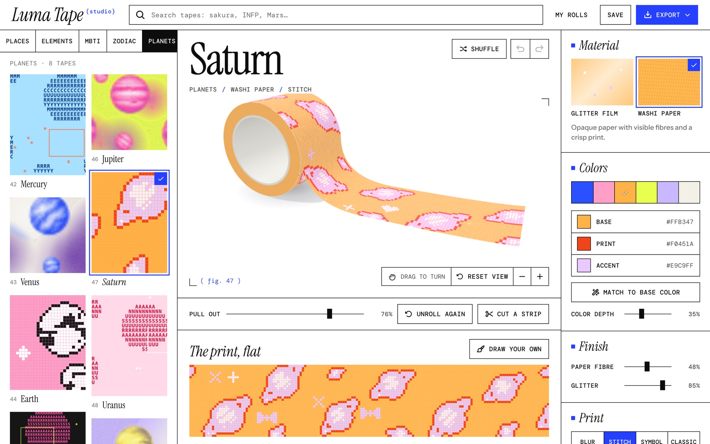
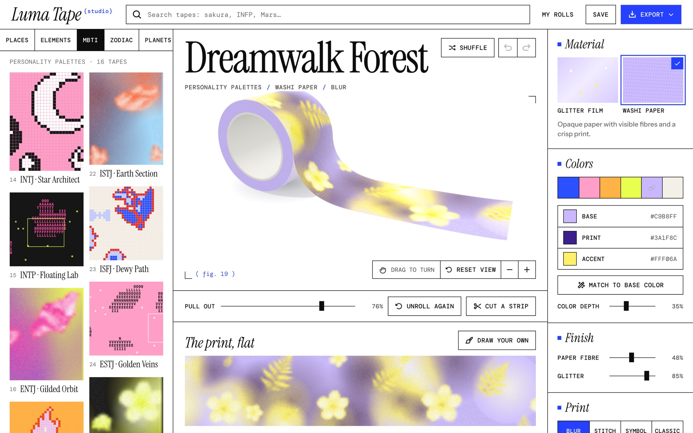
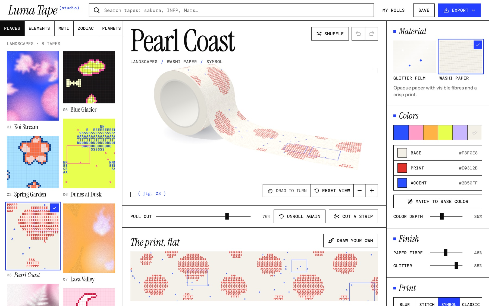

# Luma Tape

[English](README.md) · 简体中文

**在浏览器里设计你自己的手账胶带。选一个图形，换成柔焦、十字绣或字符风格，导出成电子手账能直接用的贴纸。**

[打开创作台](https://cynthiawongss.github.io/luma-tape/)



## 能做出什么

每卷胶带从 57 个图形里选一个起步，可以用四种印花风格重新呈现。卷筒、平面预览、图库封面和导出文件都来自同一份印花，所见即所得。

| Blur | Symbol |
| --- | --- |
|  |  |

- **Blur**：柔焦加胶片颗粒，按你的配色重新上色。
- **Stitch**：带描边的像素十字绣，落在织物网格上，空隙里有像素小图。
- **Symbol**：图形由成行的字母排出来，周围带小符号和细线框。
- **Classic**：原始的水彩插画。

## 功能

- **6 个系列共 57 个图形**：Places、Elements、MBTI、Zodiac、Planets、Florals，另有空白卷。
- **两种材质**：看得见纤维的不透明纸胶带，或转动时会闪的透明闪粉薄膜。
- **每卷三个颜色**：底色、印花色、点缀色。*Match to base color* 按底色自动配出另外两个，*Shuffle* 一键换一组配色和风格。
- **自己画**：画笔、橡皮、39 张贴纸、文字、上传图片，支持撤销和重做。
- **My rolls**：想存多少卷都行，可以改名、删除（可撤销）。
- **三种导出**：
  - 平铺胶带，3072 × 512，适合 GoodNotes 等电子手账
  - 透明底贴纸，2400 × 1400
  - 白底展示图，2400 × 1600
- **键盘可用**：方向键转动卷筒，Home 复位，⌘Z / ⇧⌘Z 撤销重做。
- **可分享链接**：`#/t/<图形 ID>` 直接打开某个图形。

## 你的数据

所有内容都留在你的浏览器里。没有账号、没有服务器、没有云同步。保存的作品在 `localStorage`，换设备或清除网站数据之前请先导出 PNG。

## 本地运行

需要 Node.js 20.19 或更新版本。

```sh
npm ci
npm run dev
```

检查与构建：

```sh
npm test
npm run build
```

## 发布

公开网站由 GitHub Pages 从 `gh-pages` 分支提供。推送到 `main` 不会发布。发布当前代码：

```sh
./scripts/deploy-pages.sh
```

## 技术构成

React 19、Vite、Three.js，没有后端。

```text
src/
  Studio.jsx        主界面、状态、撤销重做、存档、导出
  Library.jsx       系列、搜索、瀑布流封面
  DrawingEditor.jsx 画布
  WorksDrawer.jsx   My rolls
  patterns.js       印花：构图与四种风格
  waterScene.js     Three.js 卷筒、材质、导出渲染
  waterGeometry.js  连续的卷筒与展开曲面
  catalog.js        图形、系列、配色
  works.js          存档格式与迁移（有测试）
  color.js          OKLCH 配色推导（有测试）
tests/              存档、配色、材质、几何检查
```

## 范围

Luma Tape 是设计工具，不是印刷服务：它导出图片，不代订实体胶带。四种风格重新呈现的是同一套 39 张插画，所以各风格共用图形。字体从 Google Fonts 加载，离线时退回系统字体。
